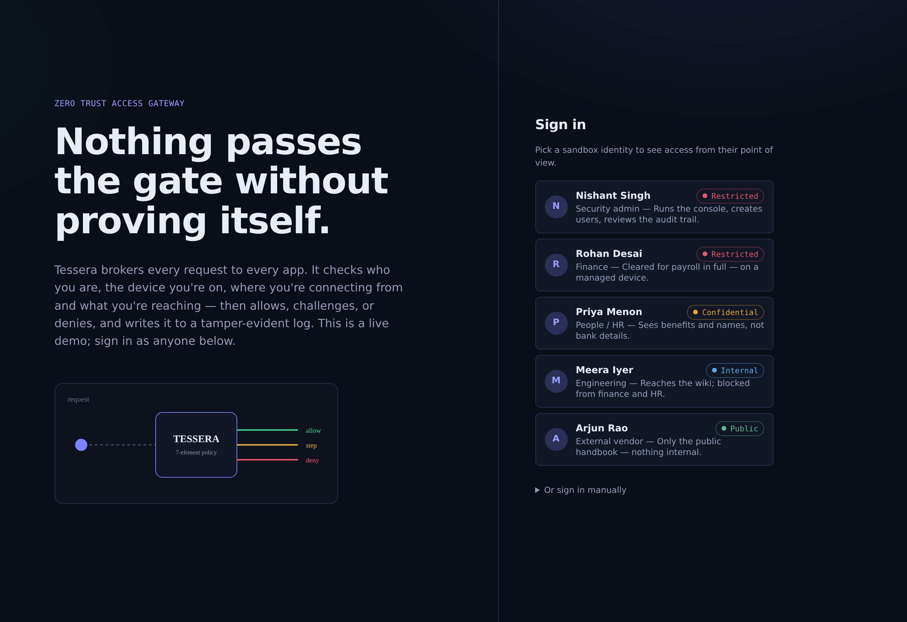
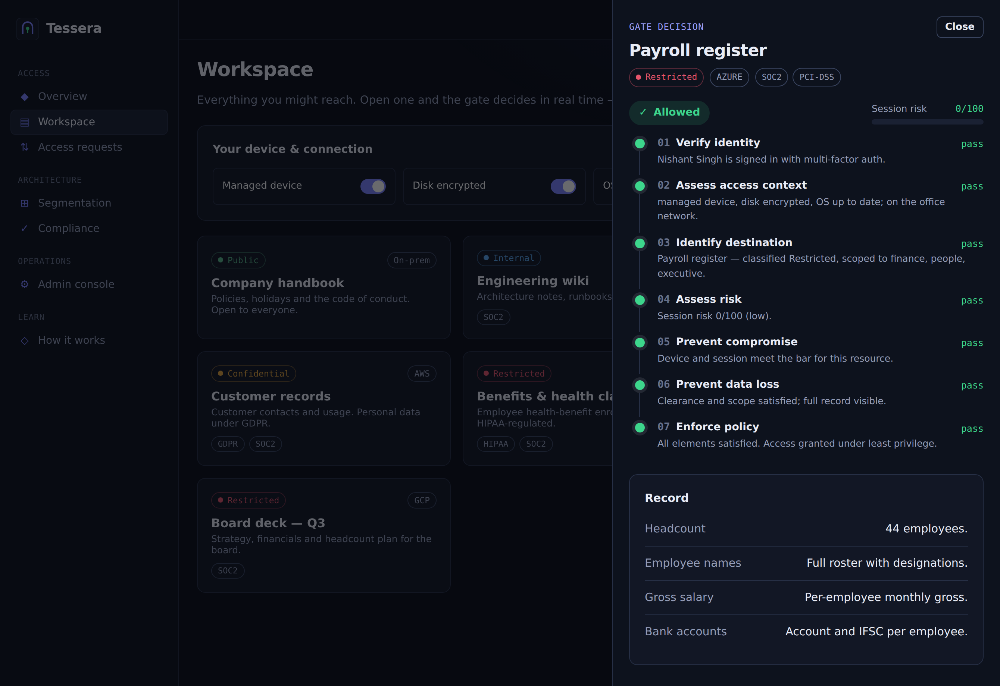
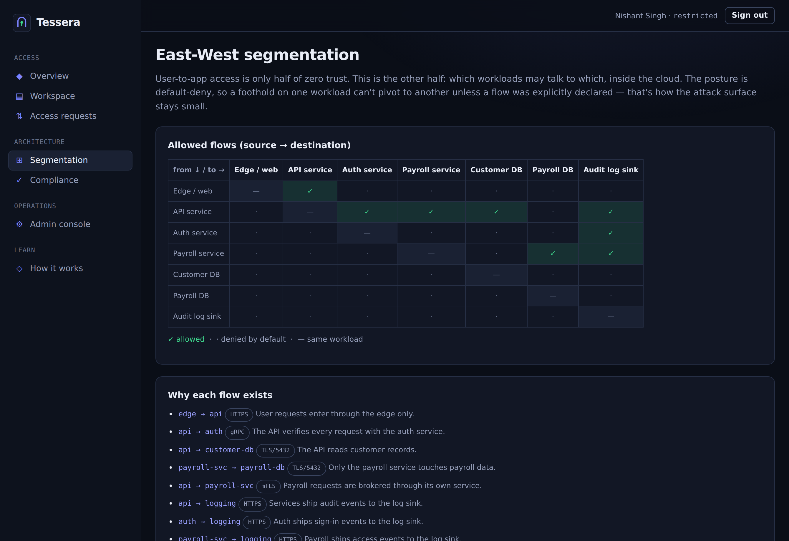
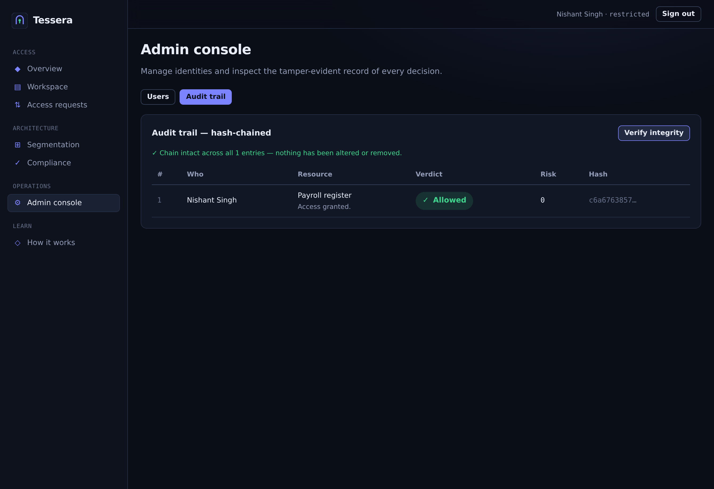

# Tessera

**A working zero-trust access gateway.** Tessera brokers every request to every app through a single guarded gate. On each request it verifies who you are, the device and network you're on, where you're going and how sensitive it is, then **allows, challenges (step-up), or denies** — and writes the decision to a tamper-evident log. It's a live demo you can sign into as five different people and watch least-privilege access enforced in real time.

**Live:** https://tessera-nishant.netlify.app &nbsp;·&nbsp; **Author:** [Nishant Singh](https://nishant-singhaa0240274.netlify.app)



## The idea

Old security trusted anything inside the network perimeter. Zero trust removes the perimeter: **never trust, always verify** — every request is authenticated, authorised and inspected, no matter where it comes from. Tessera is that model as running code, built around the **seven elements of a zero-trust architecture**:

1. **Verify identity** — who is connecting
2. **Assess access context** — the device posture and network
3. **Identify destination** — the resource and its classification
4. **Assess risk** — an adaptive score from the live signals
5. **Prevent compromise** — hard device rules and step-up re-verification
6. **Prevent data loss** — clearance vs classification, with field-level redaction
7. **Enforce policy** — a default-deny, least-privilege verdict



## Try it

Sign in as any sandbox persona (the 2FA code auto-fills for the demo). Shared password: `Sandbox#2026`.

| Persona | Role | Clearance | What they can reach |
|---|---|---|---|
| Nishant Singh | Security admin | Restricted | Everything, plus the admin console and audit trail |
| Rohan Desai | Finance | Restricted | Payroll in full — on a managed device |
| Priya Menon | People / HR | Confidential | Benefits and names, but **not** bank details |
| Meera Iyer | Engineering | Internal | The wiki; blocked from finance and HR |
| Arjun Rao | External vendor | Public | Only the public handbook |

**Things to try:** open the payroll register as the vendor (denied), then as finance (allowed). In the workspace, flip your device to *unmanaged* and watch a clean allow turn into a step-up or a block. Request just-in-time access to something you're denied, approve it as the admin, and reach it under a time-boxed grant.

## Features

- **Real authentication** — passwords hashed with PBKDF2-SHA-256 (210k iterations), RFC 6238 TOTP two-factor, and **WebAuthn passkeys** for phishing-resistant sign-in.
- **The seven-element policy engine** — pure, unit-tested decision logic returning allow / step-up / deny with a reason for every element.
- **Least privilege + data-loss prevention** — resources carry a classification and department scope; fields above your clearance are **redacted, not returned**; restricted data demands a managed device.
- **Adaptive step-up** — elevated risk or weak auth triggers re-verification; a managed-device rule or insufficient clearance can't be stepped past.
- **Just-in-time access** — request elevation, an admin grants it, and it **expires on its own** (15 minutes).
- **East-West microsegmentation** — a default-deny matrix of which workloads may talk to which, so a foothold can't pivot.
- **Tamper-evident audit** — every decision is **hash-chained** to the last; an integrity check recomputes the chain and pinpoints any alteration.
- **Encryption at rest** — TOTP seeds sealed with AES-256-GCM.
- **Brute-force protection** — failed-login lockout with escalating backoff.
- **Compliance posture** — resources mapped to NIST CSF, SOC 2, HIPAA, PCI-DSS and GDPR.
- **Hardened delivery** — strict Content-Security-Policy and security headers.




## Architecture

```
Browser (React) ──▶ /api/*  (the gate — one Netlify Function)
                      │
                      ├─ auth: PBKDF2 password · TOTP · WebAuthn passkeys
                      ├─ policy engine: the 7 elements, default-deny
                      ├─ resources: classification, scope, field redaction
                      ├─ JIT grants · East-West segmentation
                      └─ audit: AES-256-GCM at rest · SHA-256 hash chain
                      │
                   Netlify Blobs  (users, sessions, audit, grants, passkeys)
```

Everything enters through one function. There is no other path to a resource — the single brokered gate is the whole point.

### API

| Method | Path | Purpose |
|---|---|---|
| POST | `/api/login` · `/api/verify` | Password step, then TOTP; issues a signed, HttpOnly session |
| POST | `/api/passkey/*` | WebAuthn registration and authentication |
| GET | `/api/resources` | The catalogue the signed-in user may see |
| POST | `/api/access` · `/api/stepup` | Run the policy engine; return the record or a step-up |
| GET | `/api/segmentation` | Workloads and the allowed-flow matrix |
| GET/POST | `/api/requests` · `/api/requests/decide` | Just-in-time access requests and approvals |
| GET/POST/DELETE | `/api/users` | Admin: manage sandbox users |
| GET | `/api/audit` · `/api/audit/verify` | The hash-chained log and its integrity check |

## Tech stack

TypeScript everywhere · React 18 + Vite · Netlify Functions (Node 22) · Netlify Blobs · `@simplewebauthn` · Node `crypto` (PBKDF2, AES-256-GCM, HMAC) · hand-built SVG · GitHub Actions. No UI framework — the design system is hand-written.

## What it demonstrates

Tessera puts these certifications into running code:

- **Zscaler** — the seven elements (Mastering the Fundamentals of Zero Trust, ZTCA); the gateway/exchange model, multi-cloud workload tagging and East-West segmentation (Zero Trust Cloud, EDU-240); clearance-based DLP (Data Security / Endpoint DLP, EDU-220/222); the audit trail (Security Operations, EDU-250); secure protocols (Networking for Cyber Professionals, EDU-101); policy administration (Administrator, EDU-200).
- **Google Cloud Cybersecurity Certificate** — AAA: authentication, authorization, auditing (course 3); the security lifecycle and least privilege (course 1); compliance frameworks (course 2); logging and alert monitoring (course 4).
- **Fortinet FCF** — access control and secure network architecture.

It also goes past the courses: passkeys, a hash-chained audit log, AES-256-GCM at rest, brute-force lockout, just-in-time access and a strict CSP.

> **A deliberate boundary.** Tessera only builds the defences. It does not simulate attacks, run intrusions, or set traps — the strength is shown by the gate holding and refusing the wrong request, not by attacking it.

## Run it

```bash
npm install
npm run build
npx netlify dev          # http://localhost:8888
```

No configuration is required to run. Optional environment variables:

| Variable | Required | What it does |
|---|---|---|
| `TESSERA_KEY` | No | Server key for encryption at rest. A development default is used if unset — **set it in production.** |

## Tests

```bash
npm test          # 51 unit checks + 20 end-to-end checks
npm run typecheck # strict TypeScript
```

- **Unit** (`tests/run.ts`): the policy engine (least privilege, DLP, step-up, redaction, JIT), PBKDF2 round-trips, **RFC 6238 TOTP test vectors**, segmentation default-deny, AES-256-GCM encryption with tamper detection, and the audit hash chain (including detecting a tampered entry).
- **End-to-end** (`tests/e2e.ts`): drives the real gateway function — sign-in with 2FA, brute-force lockout, allow/deny decisions, step-up, just-in-time grants, and audit-chain verification.

CI runs typecheck, tests and build on every push (`.github/workflows/ci.yml`).

## Deploy on Netlify

Build command `npm run build`, publish directory `dist`. The functions in `netlify/functions/` and Blobs storage are picked up automatically. Set `TESSERA_KEY` under Site settings → Environment variables.

## License

MIT © 2026 Nishant Singh. A demonstration project; the sandbox data is fictional.
